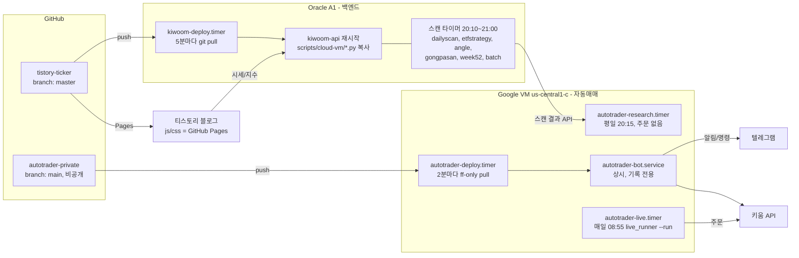

# HANDOFF / ARCHITECTURE (2026-10-30 기준)

> 비밀값(키, 토큰, 계좌번호, 해시, 외부 IP)은 이 문서에 없다. 채팅·코드·로그에도 붙이지 말 것.
> 사용자는 한국어·간결한 답을 선호한다. 명령은 항상 실행 위치를 명시한다.

## 1. 구성도

| 층 | 위치 | 비고 |
|---|---|---|
| 프론트 | 티스토리 + GitHub Pages(js/css) | |
| 백엔드 | Oracle A1, 운영 폴더 `~/kiwoom-api` | master push 후 최대 5분 내 반영 |
| 자동매매 | Google VM `instance-20260712-153038`, 사용자 `autotrader`, `~/autotrader` | main push 후 최대 2분 내 코드 반영 |
| 소스 | GitHub 2개 repo | 단일 창구 |
| 알림 | 텔레그램 (VM bot) | |

## 2. 배포 흐름 (AI 작업 규칙)

- **AI는 GitHub만 수정한다.** 서버 SSH 불필요.
- tistory-ticker → Oracle: `scripts/cloud-vm/*.py` 변경 시 복사+`kiwoom-api` 재시작. **장중 push 금지**(재시작 발생).
- autotrader-private → Google VM: ff-only pull. 로컬 변경이 있으면 중단하고 `journalctl -t autotrader-deploy`에 기록.
- VM bot 재시작은 평일 08:50~15:40 제외 시간에만 (장중 push는 코드만 받고 재시작 보류).
- git 추적 밖이라 pull로 안 바뀌는 것: `.env`, `LIVE_TRADING_APPROVAL`, `*.db`, `engine_excluded.json`, `order_*.json`.
- **실계좌 코드 주의**: `live_engine.py`, `live_runner.py`, `live_kiwoom.py`는 push만으로 실주문 로직이 바뀐다. 수정 시 사용자에게 diff를 먼저 보여주고 승인받을 것.

## 3. 자동매매 상태

- 주문 게이트(모두 충족해야 주문): `.env` `LIVE_TRADING=1` + `LIVE_TRADING_APPROVAL` 파일(날짜 이후 유효, 계좌 해시 일치) + 계좌 1개 + UNKNOWN 주문 없음 + `KIWOOM_BASE_URL` 기본값. 9Pay 신호 경로는 `NINEPAY_LIVE_TRADING=1`도 필요.
- 현재 VM: 위 스위치 ON, **`LIVE_SELL` 미설정(봇 매도 꺼짐)**. 엔진은 자기가 산 종목만 매도.
- `--check` 기준 VM과 PC 판정 동일: `holdings_clear`, `budget_funded`는 WAIT(보유종목 있음/예수금<BUDGET 100만원, 리포트 값). 실제 차단은 엔진 내부(SLOTS_FULL, NO_CASH 등).
- 휴장일은 `krx_calendar`로 live_runner가 스스로 종료 (VM에서 2026-11-02 True / 10-31 False 확인).
- 승인파일은 **한 머신에만** 둔다. 머신 간 이중주문 잠금이 없다.
- 병렬 금지: PC 봇 재가동 시 텔레그램 409 충돌 + 이중주문 위험. PC는 작업 삭제됨(LiveTrading, Bot, Research, Candidates, LivePaper). PC에 `LIVE_TRADING_APPROVAL.disabled_pc`, `NO_AUTOSTART`, `LIVE_*=0` 남아 있음.
- 연구: VM 20:15 폴링 실행, 첫 실행 검증 완료(PC와 25건 일치). 모의매매(LivePaper)는 폐기.
- Oracle 스캔은 순차 실행이라 dailyscan 지연 시 뒤 스캔이 밀린다(야간 마감 07:20).

## 4. 미확인 / 남은 일

1. **월요일 11/02 08:55 첫 실주문 경로 실행 — 미검증.** 확인(Google VM):
   `systemctl show autotrader-live.service -p Result -p ExecMainStatus` / `sudo journalctl -u autotrader-live --since 08:50 --no-pager | tail -15`
2. 토요일 08:55 휴장 종료 동작은 아직 로그로 못 봄.
3. autotrader-deploy 첫 실 push 반영 미검증 (`journalctl -t autotrader-deploy`에 `pulled` 확인). 장 마감 후 bot 재시작 로직도 첫 실행 때 확인.
4. deploy fetch 실패 시 알림 없음 (조용히 exit 0).
5. OCI 볼륨 백업, healthchecks.io, `test_tg_unit` 22개 실패 원인(주문경로 아님), `daemon-reload` 경고(Oracle, 스캔 종료 후).
6. PC `.env`의 `LIVE_SELL`은 과거 오타(`ture`)였다. 매도 허용은 사용자 별도 승인 시에만.

## 5. 운영 메모

- Windows `.env`는 `Set-Content`로 쓰지 말 것(CP949로 깨짐). Linux는 `sed -i`/`printf >>`.
- `systemd` 유닛에 `PrivateTmp` 금지(`/tmp/9pay-kiwoom-kt00018.lock` 공유).
- live.service는 `Restart=no` (불확실 시 일부러 정지).
- gcloud scp는 파일 하나씩, 절대경로 사용.
