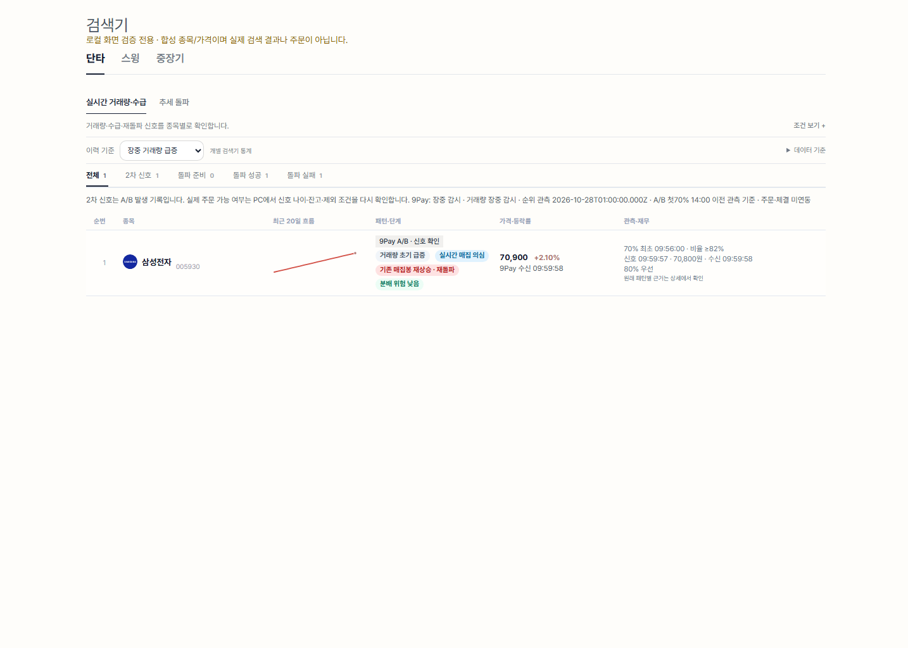
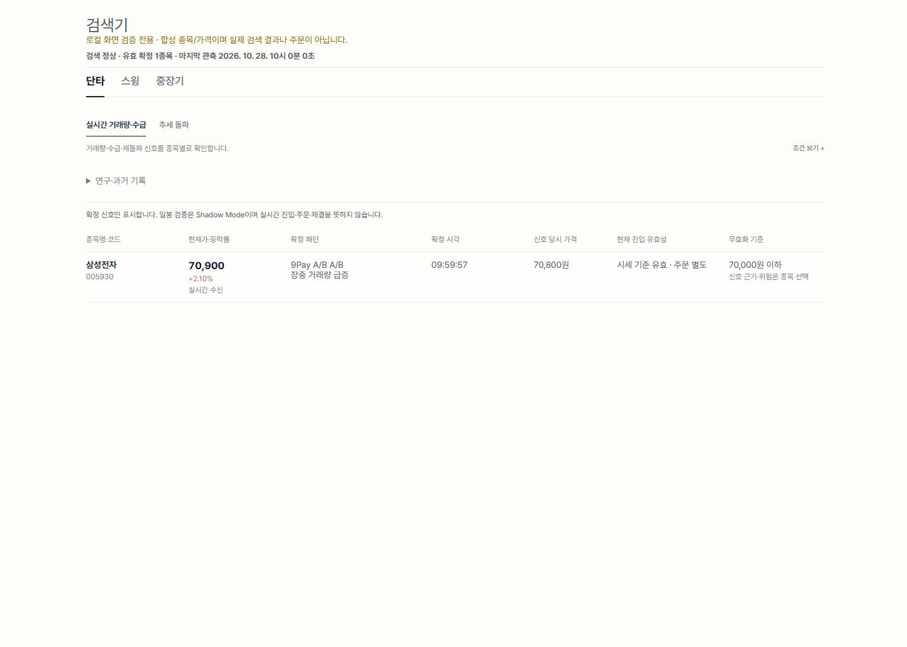
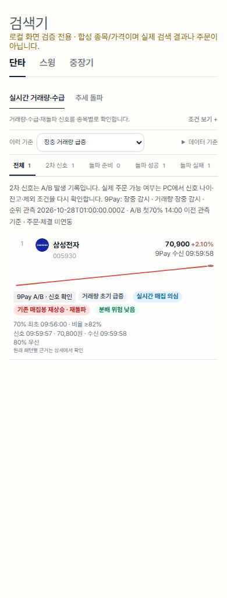
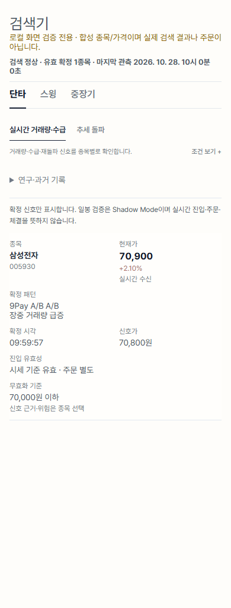

# 9Pay 확정 신호·Shadow 검증 통합 (2026-10-28)

## 적용 범위와 운영 경계

작업 브랜치 하나와 통합 PR 하나로 제공한다. **운영 배포·재시작·master 병합·PC 설치·주문 테스트·환경변수 변경은 하지 않았다.** master 병합은 Pages/VM 자동 배포를 유발하므로 이번 PR은 병합하지 않는다.

새 검증기는 항상 `mode=shadow`, `orderAuthorized=false`다. 실거래로 승격시키는 스위치는 제공하지 않는다. 기존 `ab70-v1` A/B 주문 경로·10초 신선도·14시 경계·예산·제외 상품·손절/추적 청산은 유지한다. 실거래 수익성은 입증되지 않았다.

## 실제 연결 구조

`공유 시장 피드 → 기존 패턴/관찰기 → 화면 확정 판정 또는 Shadow 평가 → 별도 PC 수신 검증 → 주문 직전 계좌·위험 검사 → 의도 장부 → 증권사 → 기존 포지션/청산`

- VM `kiwoom_9pay_observer.py`: 70% 최초 관측은 후보, 눌림 이후 A 또는 B가 기존 2차 신호다. PC는 이 A/B를 소비한다. 70%만으로 실주문하지 않는다.
- 신규 1차 평가: 기존 관측값을 재사용한다. 시세/순위 신선도, 거래량, 출처, 지원 가격, 진입 창, 누락/저장 오류, 유동성·매수 흐름 증거를 모두 요구한다. 현재 관찰기에는 마지막 두 증거가 없어 미확정으로 남는다. **미검증 데이터를 임의 생성하여 빠른 신호로 내보내지 않는다.**
- 스윙: 완성 상태, 상승 20일선, 지지 유지, 손절 거리, 저항 대비 추격 거리, 상승/하락 거래량 구조, 같은 거래일의 KOSPI 대비 상대강도를 검사한다. 시간 경과는 확정 조건이 아니다.
- 중장기: 스윙 공통 항목에 확정 주봉/월봉, 224일선 방향, 장기 저항, 재무 관문, 시장 추세를 추가한다. 현재 주/월의 미완성 자료는 제외한다. KOSPI는 명시적인 비교 기준이며 업종/종목별 최적 기준으로 검증된 것은 아니다.
- 일봉 판정에는 당일 15:30 전 봉·미래 봉·중복/역순/잘못된 OHLCV를 사용하지 않는다. 재평가는 저장 신호의 기준일까지로 자른다. 지수 자료가 없는 날짜는 다른 날짜로 보간하지 않는다.

## UI 계약

기존 `/page/pattern-scan`, 5개 패턴 묶음, 단타/스윙/중장기, 원래 패턴 설명과 검색/이력 키 및 상세 차트를 유지한다. 새 페이지나 transport를 만들지 않는다. `NineHttp`, `NineAPI`, `NineUI`, 공통 차트와 전역 색/여백 토큰을 사용한다.

- 기본 화면: 확정된 유효 신호만 종목별 한 줄. 현재가/등락률, 패턴, 확정 시각, 신호 가격, 현재 진입 유효성, 무효화 가격을 표시한다.
- A/B: 현 시세와 신호 모두 10초 이내, 순위 120초 이내, 무효화/누락/저장 오류 없음, 지지선 위, 신호가 +0.3% 이내여야 표시한다. 화면 통과는 PC 주문 승인과 별개다.
- 일봉: 신규 검증 계약의 확정 결과만 표시한다. 평가는 36시간 이내여야 한다. 일봉 가격은 스캔 가격으로 명시하고 **현재 진입은 미확인·주문 불가**로 표시한다.
- 후보/준비/실패와 원래 이력은 접힌 `연구·과거 기록`에서 명시적으로 확인한다. 내부 기록/원래 탐지기를 삭제하지 않는다.
- 장외·수신 대기·장애·지연·확정 검증 자료 미수신·정상 0건을 구분한다. 구버전 서버 결과를 확정 신호로 승격하지 않는다.
- 상단의 큰 원형 배치 표시를 텍스트로 줄이고 통계/이력은 접는다. 배치 진행률은 전략별 확정 수와 분리한다.

## 기록과 성과 계산

`signal_review.review_groups`는 기존 DB의 일봉과 지수만 읽는다. 종목별로 처리하고 신규 API 호출·수집기·상시 프로세스·타이머를 추가하지 않는다. 공통 `db_schema`가 소유한 `signal_reviews`에 `(기준일, 종목, 패턴, 검증 버전)`별 최초 증거를 기록한다. 동일 신호 재평가/재시작으로 확정 시각을 새로 만들지 않는다. 180일 보존이며 기존 `scan_hits`는 유지한다. 일봉 검증 실패도 원래 포착 이력 저장을 막지 않는다.

장중 단계 전환은 기존 크기 제한 연구 로그에 `confirmation_shadow`로 기록한다. 정상 관측과 기존 A/B 결과, 신규 체크·미충족 사유를 비교할 수 있다. 원시 호가/계좌/비밀키를 기록하지 않는다.

오프라인 `quant-autotrade/research/performance_review.py`는 명시적 JSON 입력으로 다음을 계산한다.

- 신호/확정 시각·가격, 판단 당시 이용 가능했던 호가의 시각/잔량, 신호 지연, 실제/가정 진입가 차이.
- 복수 매수/매도 체결, 수량, 수수료·세금·별도 슬리피지 비용, 비용 차감 순손익.
- 승률, 평균 이익/손실, 기대손익, Profit Factor, 청산 순서 기준 실현 최대 낙폭, 관측 표본 MAE/MFE.
- `mode=backtest/paper/forward/actual`와 `variant=first/second/swing_before/swing_after/long_before/long_after` 등 호출자가 지정한 비교군을 분리한다.
- 미체결/부분 청산은 미완료로 분리하여 완결 거래 승률·손익에 합산하지 않는다. 미래 호가·음수 비용·체결 이전 판정·중복 신호는 거부한다. 손실 0건의 PF는 무한 숫자 대신 별도 상태로 반환한다.

사용 예: `python quant-autotrade/research/performance_review.py deidentified-input.json --capital 1000000`

비용 필드는 필수다. 실제 체결가에 이미 포함된 슬리피지를 `slippageCost`로 다시 빼지 않는다(그 경우 0을 명시). 호가가 없으면 `assumed/unavailable`로 표시한다. MAE/MFE는 관측된 표본 범위이며 연속 호가의 극값이 아니다. 낙폭은 실현손익 기준이고 평가손익 낙폭은 미제공이다. **실제 주문/체결 장부의 자동 수집·웹 동기화는 연결하지 않았다.** 현재 입력된 실제 체결 자료나 성과 개선 근거는 없다.

## 피드 확인

키움/Toss 기존 허브 상태에 종목별 수신 시각·경과와 90초 내 실제 수신 종목 수를 추가했다. 메모리는 각 허브 등록 예산 내로 제한한다. 키움 등록 응답 확인 여부도 별도로 표시한다. `registered/liveCodes`를 실제 시세 수신 수로 해석하지 않는다. Toss의 손실 가능 체결을 거래량/주문 신호로 합산하지 않는다. KIS는 기존 파생/통합시장 피드·TR별 상태와 폴백 역할을 유지한다.

읽기 전용 공개 상태 확인: `/health` 응답, 키움 running/connected=true, Toss running=false/connected=0, 9Pay active=false·coverageLimit=20·signalCount=0·queueDropped=0. 이는 **장외 상태 조회**이며 400종목의 장중 정상 수신·공급자 전환 가격 정합성·동시 사용자 p95·메모리 실측의 증거가 아니다. 등록 목표 400과 단타 후보 감시 20을 혼동하지 않는다.

## 검증과 화면 비교

- 기존 패턴/추적·입력, PC 주문·리스크·중복/불확실 상태, runner/연구 전체: 478 passed + 26 subtests (Windows/Python 3.14, 합성·가짜 증권사).
- 신규 검증은 미완성 주/월, 미래 자료, 중복/역순 봉, 데이터 결측, 지지 무효화, Shadow 실주문 0건, 비교군 분리·비용·부분체결·증거 중복/재시작을 검사한다.
- 기존 제외종목 양성 대조의 미분류 `scanner=x`를 정식 `doubleBottom`으로 고쳤고, 피드 장애 테스트는 장중 고정 시각을 사용한다. 운영 정책은 약화하지 않는다.
- 실제 Edge headless 1440/390px 합성 화면 12개(장중/지연/부분장애/장외/API 오류/구버전): 가로 넘침/JS 오류 없음, 전략 전환, 7개 필드, 종목 중복 제거, 연구 접근, 주문 URL 호출 없음 확인. 실기기 검증과 다르다.
- 화면 비교는 같은 고정 시각·합성 응답으로 master 원본 JS/CSS와 변경 JS/CSS를 렌더한 것이다. 운영 화면이나 수익성 비교가 아니다.

## 운영 전환·롤백

1. PR CI와 변경 파일을 검토한다. 신호 판정/실거래 전환 승인으로 해석하지 않는다.
2. 배포가 승인되면 장외 유지보수 창에 현재 피드/미체결/불확실 주문/PC 설치 버전·포지션 상태를 읽기 확인한다. 전체 변경을 함께 배포해야 구버전 검증 계약 미수신이 장기화되지 않는다.
3. master 병합의 Pages/VM 자동 배포를 확인하고 기존 `/health`, 읽기 API, 다음 정규 배치 증거, 장중 수신 수·90초 결측·큐 누락·메모리·p95를 점검한다. PC 파일 설치/스위치는 별도 승인 대상이다.
4. 실거래 신규 전략은 활성화 경로가 없다. 전향 표본·시장 구간·비용 민감도·체결 가능성·기존 방식 비교가 확보된 뒤 별도 PR/승인으로 설계한다.
5. 실패 시 이번 통합 커밋을 되돌린다. DB 추가 테이블은 기존 코드가 무시하므로 주문/포지션/의도 장부를 삭제하거나 재구성하지 않는다. 누락 누계·STOP·계좌 승인·기존 위험 한도를 초기화하지 않는다. 롤백 배포/재시작도 운영 승인 범위에서 수행한다.

**상태:** 구현/오프라인 검증 완료 범위와 운영/수익성 미검증 범위를 위와 같이 분리한다. 라이브 호가/매수 흐름 증거 연결, 실체결 자동 연계, 400종목 장중·동시 접속 부하 실측, 신규 전략의 수익성 검증은 남아 있다.
