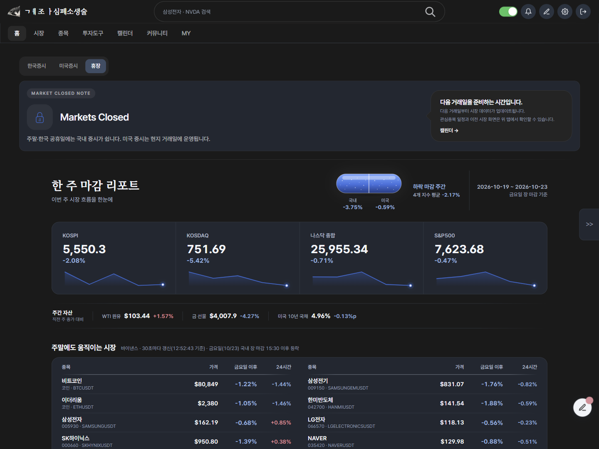
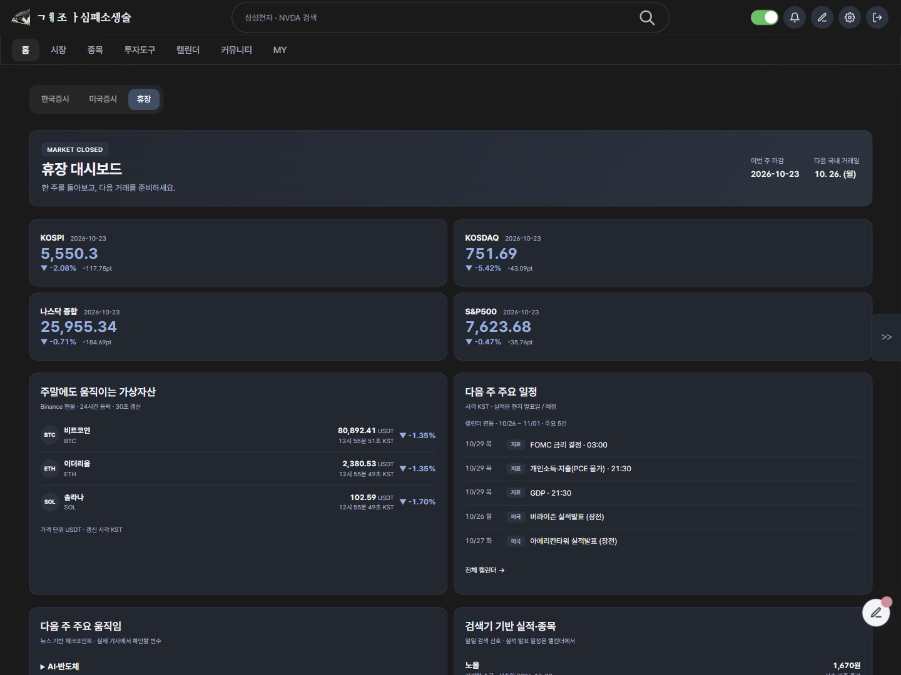
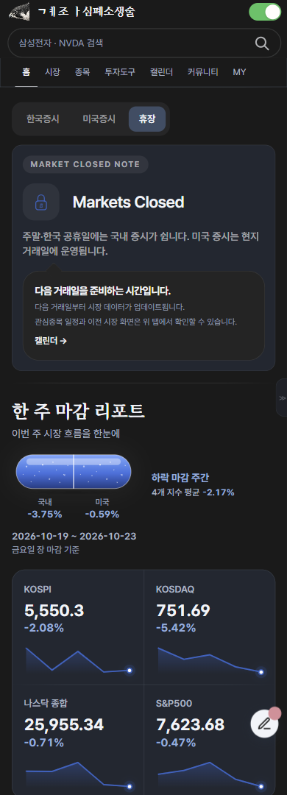
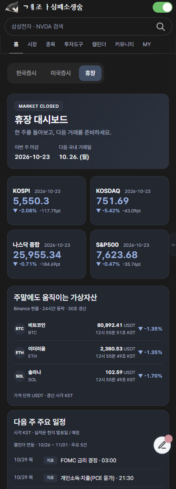

# 휴장 대시보드 검증 — 2026-10-24

별도 브랜치 `feature/weekend-dashboard-redesign`. 사용자 승인 전 master 병합/배포 금지.

## 변경 범위

- `js/home-weekly-report.js`: 기존 주간 응답을 새 배치로 표시. 주요 지수 2×2, 각 108px, 종가·주간 %·포인트·최종 봉 날짜. 서버 계산값 재사용, 그래프/중복 자산/종목 성과 섹션 제거. 상세 시장지표 링크 유지.
- `css/home-weekly-report.css`: 누적된 옛 휴장 CSS를 전용 `.weekend-dashboard` 컴포넌트로 교체. 공식 `--ui-*`/`--dk-*` 토큰 사용. 제목만 기존 `np.np` important 규칙과 같은 레이어에서 Pretendard 지정. 나머지 컴포넌트는 일반 scoped 규칙.
- 일정: 기존 StockCalendar(경제·실적 통합) 사용, 중요 지표→관심종목→지표→기타 우선, 중복 제거, 최대 5건. KST 시각/실적 현지 발표일·예정 표기. 실패 시 기존 주간 일정 유지.
- 코인: 기존 Binance 현물 ticker/24hr, BTC/ETH/SOL 3회/30초. SOL 실제 공급 경로 응답 확인. USDT 표시, 공급자 closeTime 시각, 부분 실패 시 자산별 마지막 유효 가격/시각 및 갱신 지연 표시. 숨겨진 휴장 탭에서는 요청 중지. 기존 토큰/금요일 기준 봉 요청은 요약 화면에서 제외.
- 뉴스: 기존 `/weekend-us-themes` 사용. 출처·날짜·실제 링크가 있는 기사만, 중복 제거, 최대 5테마. 각 테마를 펼치면 실제 기사와 출처 표시. 오류/빈 상태 구분.
- 검색기: 기존 `/pattern-scan` 저장 결과를 5분간 요청 공유. 기존 5개 그룹별 첫 유효 종목을 최대 1개, 총 5개, 코드 중복 제거. 신호일/신호 종가/스캔시각 표기. 기존 financialScreen.annual에 비교 연도와 net_income_yoy_pct가 있으면 실제 연간 순이익 YoY도 표기. 검색 신호를 확정 실적으로 표시하지 않음. 빈 응답과 통신 실패 구분. 스캔/재무 알고리즘 변경 없음.
- 마지막 마켓브리핑/학습 자료: 원래 DOM에서 각 3개, 제목·요약 2줄, 카드 194px. 기존 SiteInteractions.carousel 재사용. 휴장일 때만 중복 원래 영역 숨기고 국내/미국 탭에서는 복원. 사용자 확인대로 이야기 시리즈는 기존 하단 학습 자료를 사용.

## 화면

후보는 실제 운영 홈에 브랜치 JS/CSS만 임시 적용하여 검증. 금융 데이터는 실제 API 응답이며 테스트용 수치 주입 없음. 운영 배포는 하지 않음.

| | 변경 전 | 변경 후 |
|---|---|---|
| PC 1440 다크 |  |  |
| 모바일 390 다크 |  |  |

375/390/768/1280/1440 × 라이트/다크: 문서 가로 넘침 0, 지수 카드 108px·2×2 유지, 메인 패널 여백 모바일14px/PC18px, 다크 면 rgb(32,39,49), 제목 Pretendard. 일정 5행, 브리핑/학습 각 3개. [실측](computed-styles.json).

읽기 캐러셀 6개 카드 높이 모두194px, 브리핑 버튼 이동530px/학습 트랙0px로 독립 이동 확인. 미국 시장 전환 후 휴장 root hidden=true, 원래 브리핑 block/하단 학습 grid 복원. 신규 UI의 자동 실행 예외 미관측. 375px에서 지수·코인 행 자체 넘침 없음.

## 검사

- Node: `node --test test/test_weekend_dashboard.js test/test_site_interactions.js test/test_weekly_candidate_rows.js test/test_home_us_session_single_status.js` → 23 pass.
- Python: `python -m pytest test/test_weekly_report.py test/test_weekly_futures_cache.py test/test_market_hours.py test/test_home_closed_briefing.py test/test_home_weekly_report_css.py -q` → 56 pass / 65 subtests.
- JS 문법, `git diff --check` 통과.
- 제거된 옛 종목 CSS를 강제하던 기존 CSS 계약 4개는 새 목록의 독립 리셋/구분선/테마 토큰 계약으로 변경. 신규 동작 검사: 지수 계산값 보존/배치, 코인 부분 실패와 마지막 값 유지·숨김 폴링 중단, 스캐너 중복/빈값/오류, 뉴스 출처 검증·중복 제거.

## 제한 및 배포

- 최종 렌더링 참고 이미지는 이번 첨부에 없으므로 텍스트 지시의 순서와 토큰을 기준으로 구현.
- 학습 자료에는 게시일이 없어 원래 순서의 첫3개를 표시하고 `상시 학습 자료 · 게시일 미제공` 명시. 최신순 날짜를 만들지 않음. 전체 라이브러리는 기존 링크 유지.
- 개인 계정 저장·인증·실거래 및 실제 평일 장중 데이터 갱신은 변경하지 않았고 실행 검증 범위가 아님. 기존 판정 단위검사와 국내/미국 탭 복원으로 회귀 확인.
- 승인 후 master 병합 시 Pages JS/CSS 반영. `skin.html`, VM/GAS, DB, 수집·자동매매 변경 없음. 티스토리 관리자 수동 스킨 반영 불필요. 이번 작업에서는 병합/배포하지 않음.
