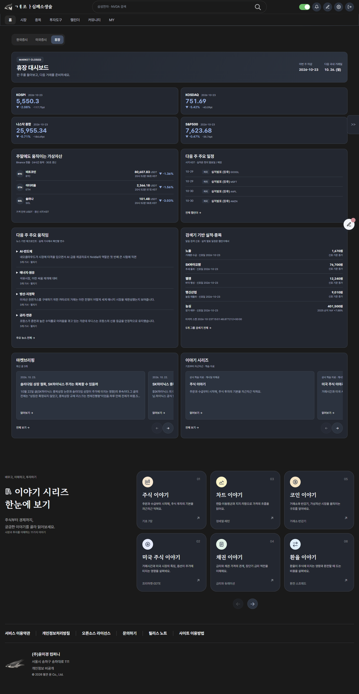
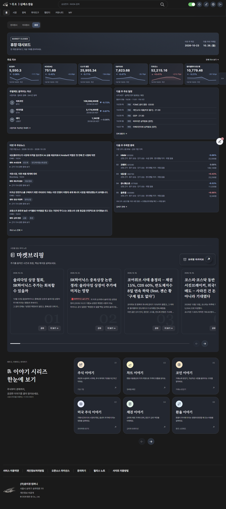
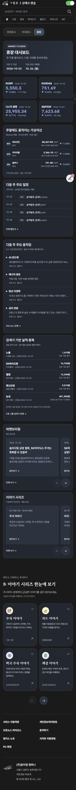
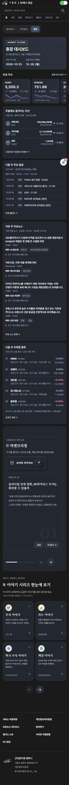

# 휴장 대시보드 원본 복원·컴팩트 카드 검증

## 운영 배포 확인 — 2026-10-24 22:30 KST

사용자의 후속 “배포해” 승인에 따라 [PR #966](https://github.com/goodbyestarwars/tistory-ticker/pull/966)을 master `31db75b3`로 병합했다. [Pages build/deploy](https://github.com/goodbyestarwars/tistory-ticker/actions/runs/40098340223) 22:30:17 KST 성공·built. 임시 자산 연결 없이 실제 운영 홈에서1440/390 라이트·다크 모두 지수/그래프6개·높이135px·브리핑8개·이야기11개/영역1개·하단 중복0·가로 넘침0 확인. 원래 브리핑 버튼348px 이동, 미국증시/휴장 전환 시 원본 복원, 시장지표 공유 가상자산 모듈 확인. [운영 실측](deployed-styles.json). skin.html 수동 반영이나 VM/GAS 배포는 필요 없다. 아래 내용은 배포 전 검증 기록이며 전체 세로 길이 증가·기존 오류 등의 한계는 유지된다.

## 배포 전 검증 기록

2026-10-24 KST. 브랜치 `fix/weekend-content-restore`. 최신 두 작업지시서의 고정 와이어프레임을 우선했다. **사용자 승인 전 master 병합·운영 배포하지 않는다.**

## 원인과 복원 근거

직전 리디자인 커밋 `a1e5f137`의 부모와 현재 소스를 비교했다. 원래 `skin-main.js`의 마켓브리핑은 홈 게시물 8개를 담은 `.home-briefing-section`, `skin-shell.js`의 이야기 자료는 링크·설명·SVG가 있는 `.site-footer-learn` 11개다. 이 원본 파일/카드 데이터를 과거 버전으로 통째로 덮어쓰지 않았다.

문제는 `home-weekly-report.js`의 `contentShelf()`였다. 원본 앞 3개씩만 새 링크 카드로 재작성하고 원본 브리핑을 숨겨, 나머지 게시물과 원래 공유·더 보기·캐러셀 기능이 새 영역에서 빠졌다. 이야기 원본 숨김은 비레이어 important였으나 기존 `np.np` important 표시 규칙에 져서 하단 원본과 중복됐다.

이제 두 원본 영역을 마지막 읽기 영역으로 **이동**한다. 복제·요약 재작성·3개 제한은 없다. 주석으로 원래 자리를 보존하고 국내/미국 탭에서는 같은 노드를 원래 위치로 돌려준다. 캐시본→새 응답 재렌더 전에 원본을 먼저 복원하여 innerHTML 교체가 원본까지 지우지 않게 했다. 위젯 초기화/탭 전환도 같은 배치 함수를 사용한다.

이야기를 옮기면 푸터의 기존 `:has(학습 카드)` 조건이 풀리므로 `data-weekend-learn-slot` 동안도 **기존 푸터 규칙**이 적용되도록 선택자를 확장했다. 새 전역 덮어쓰기 대신 원래 규칙을 재사용하며 평일에는 마커를 제거한다.

## 실제 구현

- 주요 지수: KOSPI/KOSDAQ/NASDAQ/S&P500/DOW/SOX, PC 6개 한 행, 135px 높이·8px 간격·12px 패딩·20px 수치. 좁은 폭은 내부 가로 스크롤, 모바일 카드 폭156px. SVG 방향 아이콘과 26px 면적 그래프.
- 앞 4개 지수는 기존 주간 응답의 수치를 그대로 사용한다. DOW/SOX는 이미 운영되는 `/futures?interval=day&days=30&symbols=DOW_INDEX,SOX`의 저장 봉을 화면에서 같은 주간 기준으로 표시한다. YYYYMMDD/ISO 날짜 정규화, 주 종료일 이후 봉 제외, 직전 주 종가 대비. 휴일/자료 부족은 실제 최근 봉 날짜를 표시하고 시계열이 없으면 그래프 생략. 수집기·서버 계산·DB 변경 없음.
- 가상자산: **현재 시장지표와 같은 BTC/ETH/USDT, 업비트 원화**를 사용한다. SOL은 그 원본 목록에 없으므로 임의 추가하지 않았다. `CryptoMarket.fetchCoinQuotes()`를 양쪽 화면이 함께 사용하며 진행 중 요청/30초 캐시를 공유한다. 기존 30초 갱신 유지, 숨김 탭 중지, 실패 시 자산별 마지막 유효 가격/공급 시각·갱신 지연 표시. 새 WebSocket 없음. 원화 USDT와 Binance USDT 표시를 혼동하지 않는다.
- 일정: 기존 StockCalendar 데이터·우선순위·5건·링크·KST/예정 표기를 유지하고 UI 간격만 정리.
- 뉴스: 기존 `/weekend-us-themes`의 기사→테마→`krSectors` 분류 관계 복원. 기사 링크·출처·날짜, 실제 업종 pill. 근거가 없는 업종은 만들지 않으며 기사 링크 중복 제거. 관련 종목과 나머지 기사는 항목 안에서 펼쳐 읽는다. 제목은 요청대로 ‘이번 주 주요뉴스’, 실제 제공 범위(금~일)는 별도 표기한다.
- 종목: 리디자인 이전 `weekly-report.hotCandidates.domestic`의 2주 스윙 후보와 선정 근거를 다시 사용한다. 새로운 `/pattern-scan` 첫 종목 선정으로 바꾸지 않는다. 후보 가격·등락·종목 상세 링크 유지.
- 마지막: 마켓브리핑 다음 이야기 시리즈, 그 다음 바로 기존 푸터. 이전 명조 제목·카드·SVG·설명·전체 순서·캐러셀·공유/더 보기 유지. 모바일 브리핑 소개는 줄바꿈만 보완했다. 휴장 속 위젯 편집 버튼은 숨기고 평일에서는 그대로 사용.
- 공식 다크 토큰·라이트 색상 유지. 새 지표/뉴스 UI는 Pretendard, 본문14px, 수치 tabular-nums. 원본 읽기 컴포넌트의 의도된 명조는 보존.

## 브라우저 화면

실제 `ghlee.tistory.com` 문서를 사용하고 변경된 **정적 JS/CSS 응답만 로컬 브랜치 내용으로 교체**한 미리보기다. 금융 API·게시물·일정은 실제 응답이며 테스트 수치/콘텐츠를 주입하지 않았다. 운영 사이트에는 배포하지 않았다.

| 화면 | 운영 변경 전 | 수정 후보 |
|---|---|---|
| 1440 다크 전체 |  |  |
| 390 다크 전체 |  |  |

[1440 라이트](after-1440-light.png) · [1280 라이트](after-1280-light.png) · [1280 다크](after-1280-dark.png) · [390 라이트](after-390-light.png)

[수정 전 실측](before-metrics.json) · [수정 후 computed style](computed-styles.json)

1440/1280/390 × 라이트/다크 모두 문서 가로 넘침0. PC 지수 카드218/200×135px, 모바일156×135px. SVG 방향6개·실제 면적 그래프6개·가상자산 SVG3개. 본문14px Pretendard, 다크 카드 rgb(32,39,49), 브리핑8개·이야기11개·이야기 영역1개·푸터 내 중복 이야기0개.

상단 지수 영역은226→139px로 줄이면서 4개에서6개로 늘었다. 다만 **전체 문서 높이는 줄지 않았다**(1440 다크2784→3239px). 첫3개 축약본을 없애고 원래 큰 브리핑/이야기 컴포넌트를 요청한 세로 배치로 복원한 영향이다. 원본 카드 크기를 임의로 다시 축소하지 않았다. ‘전체 세로 길이 축소’는 미충족이며 이 차이를 승인 검토 대상으로 남긴다.

## 기능·회귀 검증

- 실제 한국증시→휴장 전환: report hidden/복원, 같은 게시물8개와 이야기11개 노드 유지, 평일 원래 위젯/푸터 위치 복원.
- 브리핑/이야기 원본 다음 버튼: 각각348px/742px 트랙 이동 확인. 원래 전체 링크/공유·더 보기 각8개 보존. 공유 핸들러는 전송 대신 테스트 수신기로 URL `/1310`·원래 제목 확인, 더 보기는 실제 원문 iframe 모달과 제목 확인 후 닫음.
- 원본 이야기 카드 outerHTML 유지. 브리핑의 `$종목명`은 기존 ticker 모듈이 비동기 배지로 변환하는 정상 동작이 있어 카드 HTML 바이트 비교 대신 노드·제목·링크·기능 보존으로 검증.
- 가상자산 실제 30초 반복 조회/공급 시각 갱신 확인. 실패/복구·부분 누락·숨김 탭 중지는 자동 검사.
- 스크롤 실측: PC 고정 헤더/메뉴 하단104px, 이야기 시작139.5px로 겹침 없음. 모바일 이야기 시작139.7px. 모바일 브리핑 머리글 잘림/페이지 넘침 수정. 관심종목을 실제 열었을 때도 가로 넘침0·지수 트랙1024px/카드164px로6개 유지, 닫기 정상. 미국증시 전환에서도 원래 푸터 위치/마커 제거 확인.
- Node 관련 검사32 pass: 원본 DOM 재배치/재렌더, 카드/날짜/실제 그래프, 뉴스 분류, 후보 재사용, 공유 시세 캐시/실패 복구, 기존 가상자산·표, 공통 캐러셀·미국 세션/차트.
- Python 휴장 배치3 + CSS8 + 미국 세션 비교4 =15 pass. JS 문법/diff check 통과.
- 추가로 실행한 기존 `test_us_session_basis.py`는11 pass/3 errors. 수정하지 않은 미국 백엔드 함수의 AST 시험 준비 코드가 `_with_session_comparison`을 로드하지 않는 기존 문제다. 이번 UI 수정에서 백엔드/그 시험은 변경하지 않았다.
- 브라우저 자동 실행에서 변경 JS 파일 예외 미관측. 기존 티스토리 관리자 공통 스크립트의 `$ is not a function` 오류는 남아 있어 ‘사이트 전체 콘솔 오류0’으로 보고하지 않는다.

## 시안과의 차이·미확인

최신 첨부 **고정 와이어프레임**과 실제 화면을 대조했다. 앞선 ‘승인된 다크 렌더링’ 원본 이미지는 현재 첨부/저장소에서 확인되지 않아 픽셀 단위 나란히 비교를 완료했다고 주장하지 않는다. Apple 첨부는 작은 가로 카드의 참고이며 승인된 휴장 렌더링으로 대체하지 않았다.

최신 지시에 따라 지수2×2→6개 가로, 작은 그래프 생략→실제 면적 그래프, 브리핑|이야기 나란히→원본을 세로로 복원했다. SOL 대신 원래 시장지표 목록 BTC/ETH/USDT를 사용했다. PC 배너142px/모바일179px로, 이전160~200px 요청보다 PC를 낮춰 최신 컴팩트 방향을 적용했다. 실제 장중 평일/개인 저장·인증·자동매매는 실행하지 않았으며 변경 범위에도 없다.

## 변경 파일·배포 영향

프로덕션: `js/home-weekly-report.js`, `css/home-weekly-report.css`, `js/crypto-market.js`, `js/skin-main.js`, `style.css`.

검사: `test_weekend_native_content.js`, `test_crypto_shared_quotes.js`, `test_weekend_dashboard.js`, `test_home_weekly_report_css.py`, `test_indicator_board.js`(이미5개인 탭을4개로 세던 낡은 기대값 정정).

문서: `docs/UI_GUIDE.md`, `docs/WORK_HISTORY.md`, 이 검증 폴더. 과거 기록/캡처는 보존.

승인 후 PR master 병합→GitHub Pages 정적 자산 반영. `skin.html` 수정 없으므로 티스토리 관리자 수동 반영 없음. VM/GAS/수집/자동매매 배포나 서버 재시작 없음. 이번에는 병합·배포하지 않는다.
